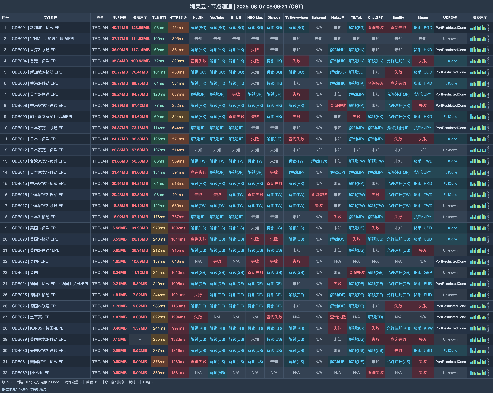

# 糖果云机场｜18 元拿下 100G，家庭设备不设上限（2026-10-31 更新）

> **一句话结论：四档家庭月付很好选：从 100G 到 1200G，都带 IEPL 与 EMBY**
>
> 👉 **[官网注册](http://candyzzyz.com/web/#/login?code=h64lQtUO)** · 先开 18 元轻量档观察家庭用量，100G 不够再往上调。

### 这几类家庭会用得顺手：

- 手机、电脑、电视需要同时接入
- 想要 IEPL 线路并顺带使用 EMBY
- 不愿为每台设备单独计算名额

### 遇到以下需求就别选：

- 准备把订阅给家庭之外的人使用
- 下单后还希望随时退款

| 选购项 | 结论 |
|---|---|
| 最低门槛 | 18 元/月，100G |
| 可选流量 | 100G—1200G |
| 速度档位 | 300—1000Mbps |
| 设备规则 | 不限，限个人及家庭成员共享 |
| 线路 | IEPL |
| 附带内容 | 赠送 EMBY |

**认识一下这家机场**：糖果云又叫 candy，套餐围绕家庭共享设计：18 元即可从 100G 开始，四档均不限家庭设备并赠送 EMBY。

## 全部套餐怎么卖

| 套餐名称 | 费用 | 流量与周期 | 设备数 | 速度 | 购买须知 |
|---|---:|---:|---:|---:|---|
| 轻量-月100G | ¥18/月付 | 100G / 每月 | 不限 | 300M | 可买重置包，家庭共享，赠送EMBY |
| 冲浪-月200G | ¥28/月付 | 200G / 每月 | 不限 | 500M | 可买重置包，家庭共享，赠送EMBY |
| 高级-月600G | ¥68/月付 | 600G / 每月 | 不限 | 800M | 可买重置包，家庭共享，赠送EMBY |
| 豪华-月1200G | ¥118/月付 | 1200G / 每月 | 不限 | 1000M | 可买重置包，家庭共享，赠送EMBY |

> 四档只允许个人和家庭成员共用，而且购买后均不退款。

## 节点测速一览

测试收录 **32 个节点**，内容覆盖下载与延迟；测试端为 **东北-辽宁电信 [2Gbps]**，逐行结果放在下图。

## 按家庭用量这样挑

1. 初次购买先从 18 元 100G 开始，300Mbps 档位适合观察一家人的实际消耗。
2. 100G 经常见底时，直接对比 28 元 200G；多人高频观看可再看 68 元 600G。
3. “设备不限”不包含对外分享，订阅只留给本人和家庭成员。

## 从这里注册

👉 **[官网注册](http://candyzzyz.com/web/#/login?code=h64lQtUO)** · 先开 18 元轻量档观察家庭用量，100G 不够再往上调。

> 该注册入口使用 HTTP；进入后先核对浏览器安全提示，再填写账号或支付信息。

*本文含推广链接；通过本文入口注册或购买，本站可能获得佣金。*

## 本文更新记录

- **2026-10-31** — 核对 4 个套餐/展示项，完成价量与限制整理。
- **2025-08-07** — 生成 B 版节点测速图，共 32 行。

---
*套餐、节点和活动可能调整，最终以购买页为准。*

展开相关搜索词

相关关键词：糖果云、candy、糖果机场、糖果云机场、机场推荐、机场测评、机场推荐2026、科学上网、代理、VPN、clash 订阅、糖果云入口、糖果云注册、糖果云测速

